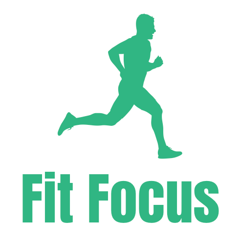
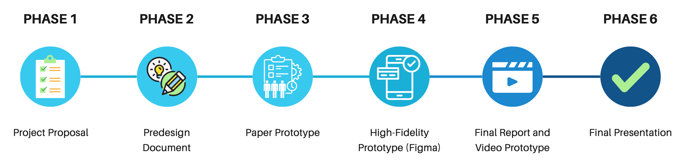

<p align="center">
  
</p>

# FitFocus: Personalized Health & Fitness App

**A mobile app concept that gives every user a diet and exercise plan built for *their* body, goals and health conditions, including diabetes and heart disease.**

> Human-Computer Interaction (HCI) team project, Imam Abdulrahman Bin Faisal University (IAU), 2025.
> Designed with **Figma**, backed by research in nutrition, exercise science and HCI.

---

## ❗ The problem

Most fitness apps give everyone the same generic plans. The wrong diet or the wrong exercise can make chronic conditions worse or cause injuries, especially for people with diabetes or heart disease. Users also lose motivation quickly without feedback or support.

## 💡 The solution

FitFocus measures each user's individual needs and builds a plan around them.

| Feature | What it does |
|---|---|
| 🥗 **Personalized meal plans** | Calculates daily calorie needs (BMR / TDEE) and adapts meals to health conditions (for example low-GI meals for diabetes), dietary preferences and cultural cuisines such as Saudi, Indian or Mexican |
| 🏋️ **Adaptive exercise programs** | Connects to smartwatches and fitness trackers, and AI adjusts the next workouts based on daily activity and performance to prevent overtraining |
| 📈 **Progress tracking** | Progress bars, charts, reminders and notifications that keep users aware of their achievements |
| 🏆 **Rewards system** | Points for logging meals, workouts and body measurements (for example 10 points a day) and bonus points for reaching goals (for example 100 points) |
| 👥 **Community & social sharing** | Share progress, join group challenges and get support from others |
| 🤖 **AI chatbot** | Real-time answers about meal plans and workouts |
| ❤️ **Health monitoring** | Tracks heart rate, calorie intake and activity, and flags unusual trends |
| 📷 **Ingredient scanning** | Scan the ingredients you have and get balanced recipes |
| 🔒 **Privacy** | Encryption, security audits and user control over data sharing |

## 👥 User analysis

| User group | Characteristics | Goals | Challenges | Preferences |
|---|---|---|---|---|
| **Individuals with chronic conditions** | Adults aged 30–65 managing conditions like diabetes or heart disease | Manage health and maintain fitness | Risk of health complications; sticking to plans | Personalized meal and exercise plans; clear guidance |
| **General health seekers** | Adults aged 18–65 with varied fitness levels | Improve overall health; track progress | Motivation; consistency in tracking | Intuitive interface; simple logging; gamification |
| **Fitness trainers & nutritionists** | Health professionals aged 25–50, tech-savvy | Support clients with tailored plans | Managing diverse client needs; data overload | Advanced analytics; client progress reports |
| **Community groups** | Local health-focused groups | Group challenges; community support | Different tech skills and engagement levels | Social sharing; community challenges |

## 🔬 Research & methodology

- **Literature research** on nutrition (caloric needs, diets for health conditions, cultural diets), exercise science and **health behavior change in HCI**, which showed that gamification, reminders and social support improve engagement.
- **User research:** online surveys and interviews with potential users, plus secondary data from the Saudi Ministry of Health and scientific journals.
- **Prototype testing:** usability testing of the Figma prototype with a small group of users. The planned tasks are:
  1. Register a new account
  2. Log a workout (type, duration, distance or weight)
  3. View the progress report (calories burned, workout frequency, charts)

### 🎯 Usability goals
Ease of learning · speed of performance · error reduction · user satisfaction

## 🗺️ Project phases

<p align="center">
  
</p>

Proposal → Predesign document → Paper prototype → High-fidelity prototype (Figma) → Final report & video prototype → Final presentation

## 📁 Repository contents

```
.
├── docs/
│   ├── fitfocus-project-proposal.pdf   # Full proposal: overview, methodology, features, AI, rewards, data collection, phases, references
│   ├── hci-research-summary.pdf        # Summary of the research paper "Health Behavior Change in HCI"
│   └── images/
└── README.md
```

---

<details>
<summary>🇸🇦 ملخص بالعربي</summary>

**FitFocus** تطبيق جوال مقترح للصحة واللياقة، يسوي لكل مستخدم خطة أكل وتمارين تناسب جسمه وأهدافه وحالته الصحية، ومنها مرضى السكري والقلب.

من مميزاته: حساب السعرات اليومية، ووجبات تناسب الحالة الصحية والذوق والمطبخ (سعودي، هندي، مكسيكي…)، وتمارين تتكيف تلقائياً بالذكاء الاصطناعي حسب بيانات الساعة الذكية. وفيه كمان متابعة التقدم، ونظام نقاط ومكافآت، ومجتمع للمشاركة والتحديات، وشات بوت للمساعدة.

مشروع مادة التفاعل بين الإنسان والحاسب (HCI)، جامعة الإمام عبدالرحمن بن فيصل.
</details>
